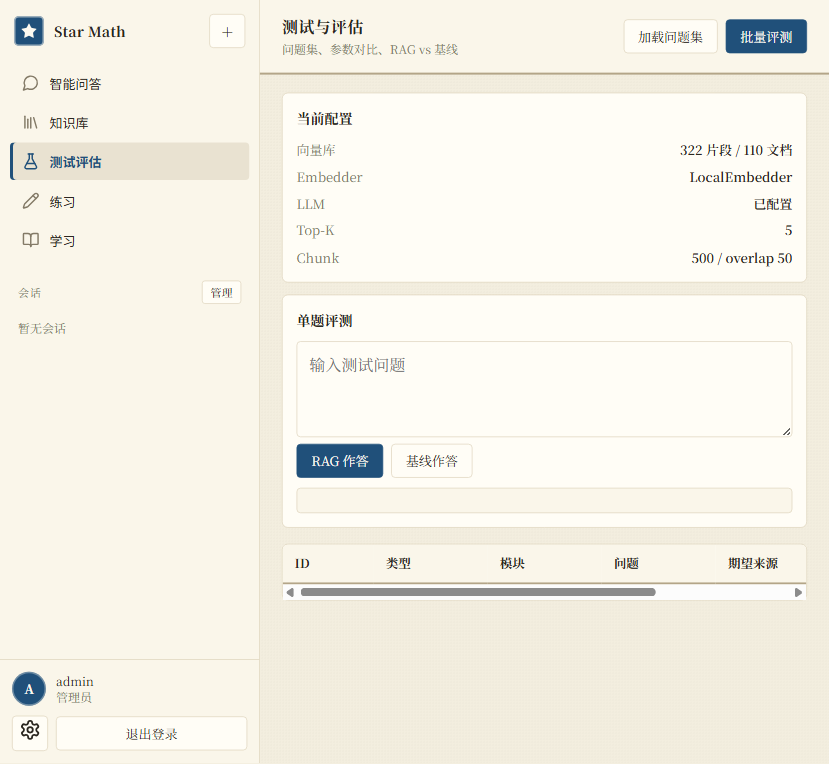

# Star Math · 基于 RAG 的数学知识库智能问答系统

面向数学领域（数学分析 / 线性代数 / 概率统计）的检索增强问答系统。支持知识库管理、带来源引用的流式问答、检索策略对比评测，以及**图片或文档上传后自动识别题目并逐题解答**。


## 功能

- **知识库管理**：上传 / 解析 / 切分 / 向量化 / 重建，支持 md、txt、docx、pdf，批量导入目录
- **检索与问答**：向量语义 + BM25 关键词双路召回，RRF 融合排序，SSE 流式输出，回答附带来源片段与引用编号
- **检索评测**：内置 100 题标注测试集，支持 RAG 与基线（直调大模型）对照、单题与批量评测
- **上传解题**：上传图片或文档 → OCR 识别题面（RapidOCR 离线，可切换视觉大模型）→ LLM 结构化切题 → 逐题检索并生成思路、分步解答、答案与知识点 → 归档习题册并导出 Markdown
- **会话与权限**：JWT 鉴权，会话历史按用户隔离



## 技术栈

| 层 | 技术 |
|---|---|
| 后端 | Python、FastAPI、Uvicorn、SQLite、自建向量库（numpy 余弦相似度）、纯内存 BM25、JWT |
| 检索 | 向量召回 + BM25 + RRF（k=60）融合；jieba 分词，缺失时回退字符 n-gram |
| 生成 | OpenAI 兼容 Chat Completions，SSE 流式；未配置密钥时降级为本地抽取模式 |
| OCR | RapidOCR（本地离线），可选 pix2text 或视觉大模型 |
| 前端 | 原生 JavaScript + HTML/CSS，无框架依赖 |

## 核心实现

### 混合检索与 RRF 融合

单用向量检索在专有术语上容易漂移，单用关键词检索又无法处理同义改写，因此两路并行召回后做融合：

- **向量路**：字符 n-gram / 远程 Embedding 生成向量，余弦相似度排序
- **关键词路**：BM25（k1=1.5，b=0.75），纯内存索引，零外部服务依赖
- **融合**：Reciprocal Rank Fusion，`score = Σ 1/(k + rank_i)`，k=60。之所以按排名而非分数加权，是因为余弦相似度与 BM25 分数的量纲不可比
- **业务加权**：概念卡文本短、BM25 底分天然偏低，会被长文本的反例集挤出候选，因此对概念卡单独加权

### 检索效果评测

自建 100 题标注测试集（概念 / 简答 / 综合 / 对比四类，标注期望来源章节与难度），Top-K=5 下的检索指标：

| 检索模式 | hit@1 | hit@3 | hit@5 | MRR |
|---|---|---|---|---|
| 向量（vector） | 97.0% | 98.0% | 99.0% | 0.9775 |
| 关键词（keyword） | 96.0% | 98.0% | 100% | 0.9733 |
| **混合（hybrid）** | **98.0%** | **99.0%** | **100%** | **0.9858** |

分模块看，关键词检索在概率统计模块的 hit@1 仅 78.6%，混合后回升至 92.9%——双路互补在术语密度低、表述多样的模块上收益最明显。评测脚本见 `backend/scripts/eval_retrieval.py`，原始结果见 `backend/storage/eval_retrieval.json`。

## 快速开始

```bash
cd backend
python -m venv .venv
.venv\Scripts\activate          # Windows；Linux/macOS 用 source .venv/bin/activate
pip install -r requirements.txt
```

模型密钥支持两种放法（优先级：进程环境变量 > 用户级密钥文件 > 项目内 `.env`）：

- **推荐**：把密钥写进项目目录之外的文件，打包/分发源码时不会连带流出。
  Windows 为 `%APPDATA%\StarMath\.env`，Linux/macOS 为 `~/.config/star-math/.env`；也可用环境变量 `STAR_MATH_ENV_FILE` 指向任意 `.env`。该文件只需三行：

  ```
  LLM_API_KEY=sk-...
  VISION_LLM_API_KEY=sk-...
  LLM_API_BASE=https://api.deepseek.com/v1
  LLM_MODEL=deepseek-chat
  ```

- **快速试跑**：直接复制 `backend/env.example` 为 `backend/.env` 填写也行。密钥留空则运行在本地抽取模式，仍可完整演示问答与检索。

需要提交或外发源码时，用打包脚本生成制品，它会自动排除 `.env*`、数据库、向量库与开发残留：

```bash
cd backend
python scripts/make_delivery.py              # 安全默认：不含密钥与本机数据
python scripts/make_delivery.py --with-data  # 连 app.db 与向量库一起打包，方便对方直接演示
python scripts/make_delivery.py --list       # 只打印将打包/排除的清单
```

导入知识库并启动：

```bash
python scripts/ingest_kb.py --path "你的知识库目录"
python run.py
```

也可双击 `start.bat`（Windows）一键拉起后端并打开浏览器。访问 <http://127.0.0.1:8000>。

管理员账号由 `backend/.env` 中的 `DEFAULT_ADMIN_USER` / `DEFAULT_ADMIN_PASSWORD` 决定，首次启动创建用户时写入数据库；若用户已存在，则沿用数据库中的口令，修改配置不会自动覆盖已有账号。

## 主要接口

| 方法 | 路径 | 说明 |
|---|---|---|
| POST | `/api/auth/login` | 登录，返回 JWT |
| POST | `/api/docs/upload` | 上传文档并入库 |
| POST | `/api/kb/ingest-folder` | 批量导入目录 |
| POST | `/api/chat` | RAG 问答（SSE 流式） |
| POST | `/api/search/debug` | 检索调试（可切换 hybrid/vector/keyword） |
| POST | `/api/eval/run` | 单题评测 |
| GET | `/api/test-questions` | 测试问题集 |
| POST | `/api/exercises/upload` | 上传文档/图片，识别习题 |
| POST | `/api/exercises/{id}/solve` | 逐题 RAG 解题（SSE 流式） |
| GET | `/api/exercises/export` | 导出习题册 Markdown |

## 目录结构

```
backend/
  app/                # FastAPI 应用
    main.py           # 路由与接口
    vector_store.py   # 向量库 + BM25 + RRF 融合
    rag.py            # 检索与生成链路
    parsers.py        # 文档解析
    exercise.py       # 上传解题与习题册
    llm.py            # LLM 客户端
    security.py       # JWT 鉴权
  scripts/            # 入库、评测、出题脚本
  data/               # 100 题测试集
frontend/             # 原生 JS 前端
ui_shots/             # 界面截图
```

## 已知限制

- 测试集为单人标注，未做双人一致性校验；hit@K 衡量的是"是否命中期望章节"，不等于生成答案的完整正确率
- 向量库为本地文件实现，规模限于千级片段；数据量增大后需要改用专用向量数据库
- 单机单用户演示定位，未做并发压测与权限分级
- LLM 令牌有时效，过期后问答接口返回 401，需重新签发
